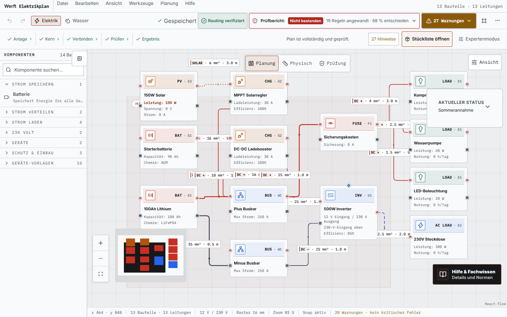
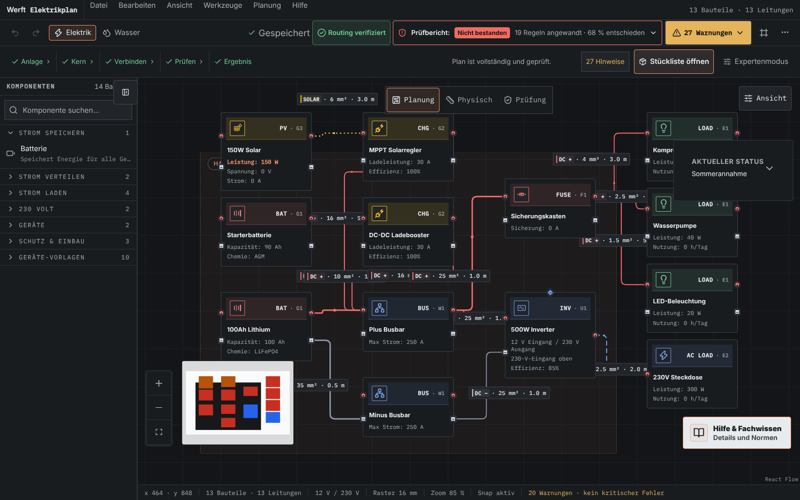
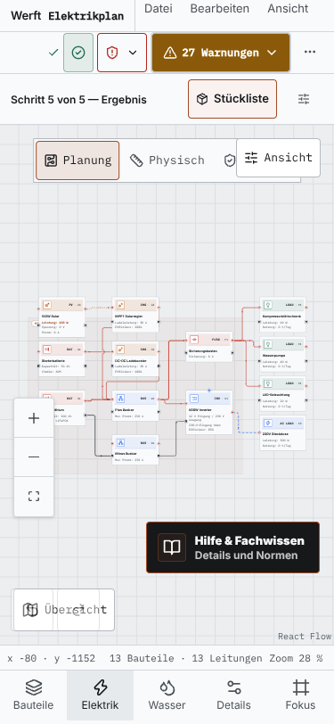
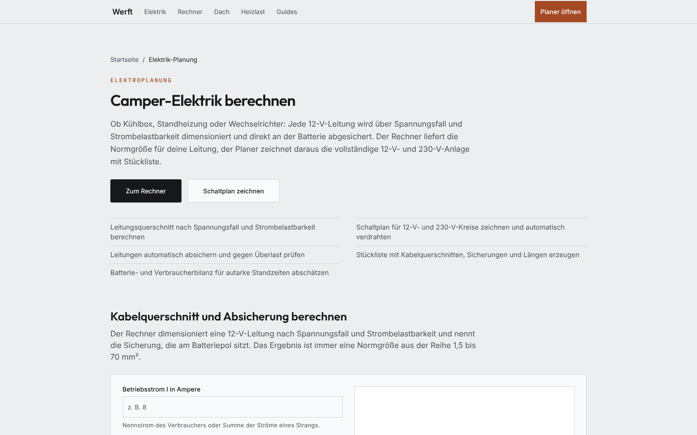
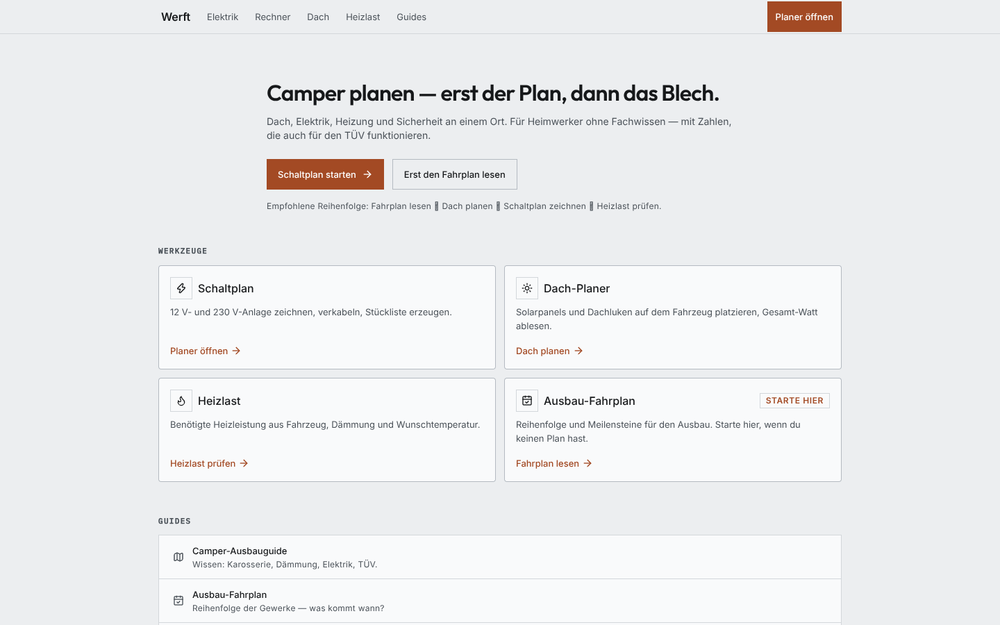

# Werft — Elektrikplaner für den Camper-Ausbau

Werft ist ein statischer Web-Planer für die Elektrik im Camper: Bauteile
per Klick oder Ziehen auf die Zeichenfläche, Leitungen automatisch
verlegen lassen — und Querschnitte, Sicherungen und Spannungsfall rechnen
sich nach konservativen VDE-Modellen selbst nach. Ohne Konto, ohne Server,
ohne Backend: Der Plan bleibt im Browser (`localStorage`), die Anwendung
wird als statischer Export ausgeliefert. **Für wen:** Menschen, die ihren
Camper selbst ausbauen und wissen wollen, ob ihr Plan trägt — nicht für
Elektrofachkräfte, die eine normgerechte Fachplanung erstellen. Die
Vorschläge sind bewusst konservativ und ersetzen keine Abnahme durch eine
Fachkraft.

**Technischer Kern:** Next.js 16 (App Router, `output: 'export'`), React 19,
TypeScript `strict` (inkl. `noUncheckedIndexedAccess`), React Flow 12
(`@xyflow/react`) als Canvas und Zustand 5 als Store — die Elektro-Domäne
(VDE-Berechnung, AutoWire, orthogonales Kabel-Routing) liegt framework-frei
in `lib/` und wird von Unit-, Property-, Golden-Master- und
Routing-Invarianten-Gates festgehalten. **Stand dieses README:** Commit-Stand
dieses PR; die Zahlen im Abschnitt „Qualitätsstand“ sind mit Datum belegt.

**Demo:** [caze7.github.io/Camp](https://caze7.github.io/Camp/) ·
Planer direkt: [caze7.github.io/Camp/planer](https://caze7.github.io/Camp/planer/)
(belegt: Pages-API `build_type: workflow` + Live-Abruf, 2026-10-12)

---

## Screenshots

Frisch aufgenommen aus dem gebauten Static Export (`npm run build` → `./out`),
Chromium headless, 2026-10-12, 1440×900 bzw. 375×812. Planzustand: der
Onboarding-Flow der Anwendung (Stromquelle Solar, Geräte Kühlschrank + LED,
Vorlage „Allround“ = 13 Bauteile · 13 Leitungen) — kein Mockup, keine
nachbearbeiteten Bilder.



_Die Anwendung als eigene Route (`/planer/`) im ganzen Browserfenster: Katalog
links, Zeichenfläche mit automatischer Verdrahtung, an jedem Kabel Querschnitt
und Länge, oben Prüfbericht und Warnzentrum — der gezeigte Stand trägt offene
Prüfhinweise, weil Entscheidungen wie RCD-Auswahl bewusst beim Nutzer bleiben._



_Dasselbe Szenario im Dark-Engineering-Theme — die Tokens sind die einzige
Farbquelle, Kontraste sind per Test-Gate geprüft (ADR 0005)._



_Auf dem Handy wird aus der Sidebar der Bottom-Tab „Bauteile“, die
Zeichengesten und die Prüfung bleiben dieselben._



_`/elektrik-planung/` ist die Wissens- und Rechnerseite neben der Anwendung:
Normzusammenhänge, Rechner und der Weg in den Vollbild-Planer._



_Die Startseite bündelt Werkzeuge und Guides; jeder Kartenlink führt in eine
indexierbare Wissens- oder Werkzeugseite — der Linkgraph ist Teil des
Export-Audits._

---

## In 30 Sekunden

```bash
npm ci          # exakte Abhängigkeiten aus dem Lockfile
npm run dev     # http://localhost:3000/planer/
npm run check   # Lint + Format + Typecheck (2 Profile) + 3309 Tests
npm run build   # Static Export nach ./out
```

Der Planer liegt auf einer eigenen Route unter `/planer/` und füllt dort das
ganze Browserfenster; `/elektrik-planung/` ist die Wissens- und Rechnerseite
daneben. Alles wird lokal im Browser gespeichert (`localStorage`, versioniert
mit Migration).

---

## Funktionen (verifiziert)

| Funktion                                                        | Wo im Code                                           | Beleg                                                                            |
| --------------------------------------------------------------- | ---------------------------------------------------- | -------------------------------------------------------------------------------- |
| Bauteil-Katalog mit Suche und Kategorien                        | `components/Sidebar.tsx`, `components/registry/`     | `Sidebar.test.tsx`, `componentRegistry.test.tsx`                                 |
| Schaltplan mit Zoom, Pan, Auswahl, Minimap                      | `components/planner/FlowCanvas.tsx`                  | `FlowCanvas.test.tsx`                                                            |
| Automatische Verdrahtung (Backbone, Sicherungen, Querschnitte)  | `lib/autoWire.ts`                                    | `autoWire.test.ts`, `vde-properties.test.ts`                                     |
| Querschnitt nach Strombelastbarkeit **und** Spannungsfall       | `lib/electrical.ts`, `lib/vde-standards.ts`          | `electrical.test.ts`, `vde-standards.test.ts`                                    |
| Sicherungsauswahl, die nie über die Kabelgrenze geht            | `lib/electrical.ts` (`selectFuseSize`)               | Gesetz G1 in `vde-properties.test.ts`                                            |
| Live-Prüfung mit Warn-Center (RCD, Überlast, Leerrohr-Füllgrad) | `components/planner/hooks/useLiveValidation.ts`      | `useLiveValidation.test.ts`                                                      |
| Orthogonales Kabel-Routing mit Hindernisvermeidung              | `components/edges/utils/routeAll.ts` (globaler Pass) | `routeAll.test.ts`, `pathfinding.test.ts`, 15 Szenarien in `scripts/regression/` |
| Stückliste mit Bauteilen und Leitungslängen                     | `components/planner/BOMModal.tsx`                    | E2E `planner-flow.spec.ts`                                                       |
| Bild-Export des Plans (PNG)                                     | `components/planner/PlannerDashboard.tsx`            | `PlannerDashboard.test.tsx`                                                      |
| Undo/Redo, Auto-Layout, Vorlagen                                | `store/usePlannerStore.ts`                           | `usePlannerStore.test.ts`                                                        |
| Wassermodus (Tanks, Pumpe, Entnahmestellen)                     | `components/nodes/WaterNode.tsx`                     | `WaterPipeEdge.test.tsx`                                                         |
| Dachplaner und Heizlast-Rechner                                 | `app/tools/dach/`, `app/tools/heizung/`              | `page.test.tsx`, `validation.test.ts`                                            |
| Bedienung auf Handy, Tablet und Desktop                         | `components/PlannerInner.tsx`                        | `PlannerInner.test.tsx`, E2E `responsive.spec.ts`                                |
| Vollbild-Anwendungsroute ohne Site-Chrome                       | `app/planer/page.tsx`                                | `app/planer/page.test.tsx`, E2E `planner-flow.spec.ts`                           |
| SEO-Inventar mit Linkgraph- und Export-Gates                    | `lib/seo/`, `scripts/seo/`                           | `scripts/seo/*.test.ts`, Export-Audit innerhalb von `npm run build`              |
| Barrierefreiheit: axe-Gate über 9 Seiten × 4 Viewports          | `tests/e2e/a11y.spec.ts`                             | 36 axe-Läufe gegen den gebauten Export, critical/serious = Fail                  |
| Pixel-Baselines je Route, Viewport und Theme                    | `tests/e2e/visual*.spec.ts`                          | 76 Baseline-Vergleiche, Pflege per `--update-snapshots`                          |

---

## Architektur

```
                    ┌──────────────────────────────────────────┐
                    │  components/registry/                    │
                    │  ComponentSpec: Label, Domäne, Handles,  │
                    │  Icon, Node-Komponente, Standardwerte    │
                    └───────────────┬──────────────────────────┘
                       liest         │        liest
              ┌──────────────────────┼───────────────────────────┐
              ▼                      ▼                           ▼
   ┌─────────────────┐   ┌────────────────────┐    ┌──────────────────────┐
   │  Sidebar        │   │  NODE_TYPES        │    │  Stückliste / Filter │
   │  Katalog+Suche  │   │  (React Flow)      │    │  Label, Domänenfarbe │
   └────────┬────────┘   └─────────┬──────────┘    └──────────────────────┘
            │ addNode                        ▲
            ▼                                │ nodes / edges
   ┌───────────────────────────────────────────────────────────────────┐
   │  store/usePlannerStore.ts        (Zustand + persist + Historie)   │
   │  nodes · edges · Auswahl · Undo/Redo · isValidConnection          │
   └───────┬──────────────────────────────────────────┬────────────────┘
           │ Zustand                                  │ autoWireSystem()
           ▼                                          ▼
   ┌────────────────────────────┐          ┌─────────────────────────────┐
   │  FlowCanvas (React Flow)   │          │  lib/autoWire.ts            │
   │  Nodes, CableEdge, Minimap │          │  Topologie: Batterie →      │
   │  routeAll.ts (Routing)    │          │  Shunt → Schienen →         │
   └────────────┬───────────────┘          │  Sicherungskasten → Lasten  │
                │                          └──────────────┬──────────────┘
                │ zeigt Warnungen                         │ Ströme, Längen
                ▼                                         ▼
   ┌───────────────────────────────────────────────────────────────────┐
   │  lib/vde-standards.ts  +  lib/electrical.ts   (VDE-Prüfung)       │
   │  Querschnitt · Sicherung · Spannungsfall · Leerrohr · RCD         │
   │  alle Größen typsicher aus lib/units.ts (Watts, Amps, Volts, mm²) │
   └───────────────────────────────────────────────────────────────────┘
```

Der Weg einer Änderung: **Sidebar → Store → Canvas → AutoWire → VDE-Prüfung →
zurück in den Store** (Querschnitte, Sicherungen, Warnungen).

---

## Tech-Stack

| Bereich   | Wahl                                                     | Version |
| --------- | -------------------------------------------------------- | ------- |
| Framework | Next.js (App Router, `output: 'export'`)                 | 16      |
| UI        | React 19, Tailwind CSS 3, Radix Primitives, lucide-react | —       |
| Canvas    | React Flow (`@xyflow/react`)                             | 12.11   |
| State     | Zustand mit `persist`                                    | 5       |
| Tests     | Vitest + Testing Library, fast-check (Property-Tests)    | 4 / 4.9 |
| E2E       | Playwright (Chromium, 4 Viewport-Projekte)               | 1.62    |
| Sprache   | TypeScript `strict`                                      | 5.9     |
| Node      | siehe `.nvmrc` (22)                                      | —       |

## Verzeichnisse

```
app/                    Seiten (App Router) — Planer, Guides, Tools, Recht
components/
  registry/             Bauteil-Registry: eine Quelle je Bauteil
  nodes/                Darstellung der Bauteile im Canvas
  edges/                Kabel- und Rohrleitungen inkl. Routing
  planner/              Canvas, Sidebar, Dashboard, Inspector, Hooks
  ui/                   generische Bausteine (Dialog, Button)
lib/
  units.ts              typsichere physikalische Einheiten
  electrical.ts         thermische VDE-Basis (Normreihe, Ampacity, Sicherungen)
  vde-standards.ts      Spannungsfall, Leerrohr, Wirkungsgrade, Validierung
  autoWire.ts           automatische Verdrahtung
store/                  Zustand-Store mit Historie und Persistenz
tests/e2e/              Playwright-Specs gegen den gebauten Export
scripts/                CI-Belege, Routing-Galerie, E2E-Server, Benchmarks
docs/                   Architektur-Entscheidungen und Nachweise
```

---

## Qualitätsstand

**Neu gemessen am 2026-10-12 auf diesem Branch** (Sandbox-Lauf: Node 22.22.3;
Chromium 153.0.8010.0 gegen den gebauten Static Export, Software-Rendering):
alle `npm run check`-Anteile, die Unit-/Komponententests, der Build, das
axe-Gate und die funktionale E2E-Suite. **Zeilen mit †** sind die zuletzt
dokumentierte Messung aus dem README-Stand vor diesem PR (ebenfalls
2026-10-12); sie wurden in diesem Sandbox-Lauf nicht erneut ausgeführt und
sind an ihr Datum gebunden.

| Prüfung                        | Befehl                                                  | Ergebnis                                                                                  |
| ------------------------------ | ------------------------------------------------------- | ----------------------------------------------------------------------------------------- |
| Typecheck (Produktionscode)    | `npm run typecheck`                                     | **0 Fehler**, `noUncheckedIndexedAccess` in der Basis-tsconfig                            |
| Typecheck (inkl. Tests)        | `npm run typecheck:tests`                               | **0 Fehler** — Einheiten und Indexschärfe gelten auch in Tests                            |
| Lint (ESLint 10, flat)         | `npm run lint`                                          | **0 Fehler** — u. a. consistent-type-imports, Tailwind-Sortierung                         |
| Format (Prettier)              | `npm run format:check`                                  | sauber, inkl. Tailwind-Klassensortierung                                                  |
| Unit-/Komponententests         | `npm test`                                              | **3309 Tests bestanden, 1 bedingt übersprungen, 241 Dateien**                             |
| Coverage-Gate (lib/**)         | `npm run test:coverage`                                 | Schwellen: Zeilen 90, Branches 85, Funktionen 90, Statements 95                           |
| Property-Tests (VDE) †         | `npx vitest run lib/vde-properties.test.ts`             | 35 Tests, ~17.000 generierte Fälle                                                        |
| Routing-Invarianten †          | `npx vitest run components/edges/utils`                 | 25 Szenarien × 7 Invarianten                                                              |
| Routing-Versatz (P0) †         | `npm run routing:audit -- --shifts`                     | 7×7-Plan-Translation: 0 Notfallpfade, 0× I1; I2 je Plan über Ratchet (Gate in `npm test`) |
| Design-Token-Gate †            | `npx vitest run lib/designTokens.test.ts`               | 174 Tests, CSS per postcss geparst, WCAG-Kontrastpaare geprüft                            |
| Build                          | `npm run build`                                         | erfolgreich, `./out` Static Export (Export-Audit: 31 Seiten geprüft)                      |
| Lockfile-Gate †                | `npm run ci:verify-lockfile-gate`                       | greift (npm ci scheitert bei Drift); `npm ci` lief in diesem Lauf drift-frei              |
| Dead-Code-Audit †              | `npm run audit:dead-code`                               | knip: letzter Lauf ohne Befund; braucht viel RAM (kein CI-Gate, ADR 0006)                 |
| Accessibility (axe, E2E)       | `npm run e2e -- a11y`                                   | 36 Läufe (9 Seiten × 4 Viewports): 0 kritische/schwere Verstöße                           |
| End-to-End (funktionale Suite) | `npx playwright test --grep-invert "hält die Baseline"` | 133 bestanden, 31 bedingt übersprungen, 0 Fehler (3,3 min)                                |
| Visuelle Baselines †           | `npx playwright test --grep "hält die Baseline"`        | 76 Vergleiche grün (Routen × Viewports × Themes, plus DE-/Pixel-Baselines)                |

**Ehrlicher Stand zur Browser-Stufe:** `npm run check`, Build, axe-Gate und die
funktionale E2E-Suite wurden für diesen PR am 2026-10-12 in einer
Sandbox (Node 22.22.3, Chromium 153.0.8010.0, Software-Rendering) gegen den
gebauten Export ausgeführt — Ergebnisse wie in der Tabelle. Die
Pixel-Baseline-Vergleiche sind bewusst **nicht** Teil dieses Laufs: Ein
Pixelvergleich unter Software-Rendering wäre kein Beleg, und der
Visuelles-Gate-Job in CI läuft dort mit identischer Hardware-Umgebung.
In CI installiert der Job den Browser selbst (`npx playwright install
--with-deps chromium`). Für lokale Läufe ohne erreichbaren Playwright-CDN
steht die Startanleitung in `docs/UI-BASELINE.md` §4; Historie und Grenzen der
Geräteemulation: `docs/E2E-TESTS.md`. Die visuellen Baselines sind an genau
einen Rendering-Stand gebunden — nach UI-Änderungen werden sie bewusst und
begründet neu geschrieben (`--update-snapshots`), niemals stillschweigend.

---

## Entwicklung

```bash
npm ci                      # niemals npm install im CI-Kontext
npm run dev                 # Dev-Server auf 0.0.0.0:3000
npm run typecheck           # tsc --noEmit (Produktionscode)
npm run typecheck:tests     # tsc --noEmit inklusive aller Testdateien
npm test                    # Vitest einmalig
npm run test:watch          # Vitest im Watch-Modus
npm run lint                # ESLint (flat config, eslint 10)
npm run format:check        # Prettier inkl. Tailwind-Sortierung
npm run check               # Lint + Format + Typecheck (2 Profile) + Tests
npm run audit:dead-code     # knip: tote Dateien/Exports/Deps (nicht build-blockend)
npm run build               # Static Export nach ./out
npm run e2e                 # Playwright (benötigt ./out und Chromium)
npm run routing:gallery     # Routing-Galerie neu erzeugen
npm run ci:verify-lockfile-gate
npx playwright test tests/e2e/visual.spec.ts --update-snapshots
                            # visuelle Baselines nach einer UI-Änderung neu schreiben
```

Für Tests und E2E wird Node.js 20.19+ benötigt; empfohlen ist die Version
aus `.nvmrc` (Node.js 22). Bei einer älteren lokalen Version bricht npm jetzt
mit einer verständlichen Meldung ab.

**CI:** Jeder Pull Request durchläuft `.github/workflows/ci.yml` →
`quality.yml` (npm ci · Typecheck · Tests · Build · E2E). Der Deploy nach
GitHub Pages läuft ausschließlich nach grünem Gate. Einrichtung der
Branch Protection: `docs/CI.md`.

---

## Architektur-Entscheidungen (ADRs)

| ADR                                                                         | Thema                          | Kurzfassung                                                                                                                                                                                                                                  |
| --------------------------------------------------------------------------- | ------------------------------ | -------------------------------------------------------------------------------------------------------------------------------------------------------------------------------------------------------------------------------------------- |
| [0001](docs/adr/0001-static-export-ohne-backend.md)                         | Static Export ohne Backend     | Keine Server, Daten bleiben im Browser — Preis: kein Geräteabgleich                                                                                                                                                                          |
| [0002](docs/adr/0002-react-flow-als-canvas.md)                              | React Flow als Canvas          | Knoten sind React — Preis: Kanten kennen fremde Handles nicht                                                                                                                                                                                |
| [0003](docs/adr/0003-orthogonales-routing-statt-wegfindung.md)              | Routing ohne Wegfindung        | Deterministisch und schnell — Preis: nicht optimal                                                                                                                                                                                           |
| [0004](docs/adr/0004-vde-modell-konservativ-und-zentral.md)                 | VDE-Modell                     | Eine Quelle, konservative Werte, typsichere Einheiten                                                                                                                                                                                        |
| [0005](docs/adr/0005-dark-engineering-theme-als-geprueftes-token-system.md) | Dark Engineering Theme         | Tokens als einzige Farbquelle, Radius ≤ 4 px, Kontraste per Test-Gate                                                                                                                                                                        |
| [0006](docs/adr/0006-planer-korrektheitskonventionen.md)                    | Korrektheitskonventionen       | PX_PER_METER-Maßstab, Selbstschleifen-Verbot, Persistenz-Rettung, NUUIA-Muster                                                                                                                                                               |
| [0007](docs/adr/0007-react-flow-bleibt-ui-adapter.md)                       | React Flow bleibt UI-Adapter   | Mess- und Interaktionsschicht; Fachlogik gehört nach `lib/`                                                                                                                                                                                  |
| [0008](docs/adr/0008-domain-model-unabhaengig-von-react-flow.md)            | Domain Model ohne RF           | Eigene Typen in `lib/domain/`; `lib/` darf keine App-Schicht importieren                                                                                                                                                                     |
| [0009](docs/adr/0009-crossings-erlaubt-overlaps-verboten.md)                | Kreuzung ja, Überdeckung nein  | Kreuzung kostet, kollineare Überdeckung und Bauteilberührung sind verboten                                                                                                                                                                   |
| [0010](docs/adr/0010-routing-ist-deterministisch.md)                        | Deterministisches Routing      | Gleiche Eingabe ⇒ byte-identisches Ergebnis; Tie-Breaker ist die Kanten-ID                                                                                                                                                                   |
| [0011](docs/adr/0011-elk-layered-als-globaler-layout-pass.md)               | ELK Layered                    | Globaler **Knoten**-Layout-Pass, asynchron außerhalb des Frame-Budgets                                                                                                                                                                       |
| [0012](docs/adr/0012-perf-budget-16ms-pro-frame.md)                         | Perf-Budget 16 ms              | CI-Gate am Referenzplan N=36/E=134, Median aus 30 Läufen                                                                                                                                                                                     |
| [0013](docs/adr/0013-react-flow-12-xyflow.md)                               | React Flow 12                  | Paketlinienwechsel von `reactflow@11` auf `@xyflow/react@12`                                                                                                                                                                                 |
| [0014](docs/adr/0014-eine-quelle-fuer-kabelgeometrie.md)                    | Eine Kabelgeometrie-Quelle     | Globaler Pass; `edge.data.geometry` und `routing-v2`-Imports sind verboten                                                                                                                                                                   |
| [0015](docs/adr/0015-harte-final-invariante.md)                             | Harte Final-Invariante         | Binäres Urteil VALID/INVALID statt Gewichtung; eine Quelle je Zuständigkeit                                                                                                                                                                  |
| [0016](docs/adr/0016-eine-elkjs-anbindung.md)                               | Eine elkjs-Anbindung           | Nur `lib/routing/elk/runner.ts`, gebündelt (`elk.bundled.js`)                                                                                                                                                                                |
| [0017](docs/adr/0017-platzierung-ohne-ueberlappung.md)                      | Platzierung ohne Überlappung   | Die AutoWire-Platzierung war die Ursache der Routing-Verletzungen                                                                                                                                                                            |
| [0018](docs/adr/0018-elk-produktiver-layout-pass.md)                        | ELK produktiv verdrahtet       | „Strukturieren“ ruft ELK, Dagre als Fallback; erzeugt keine Kabelgeometrie                                                                                                                                                                   |
| [0019](docs/adr/0019-final-gate-konsumiert-kollisionsmodell.md)             | Gate nutzt Kollisionsmodell    | I1/I2/I3 leiten aus `lib/routing/rules/collision.ts` ab, ohne eigene Schwelle                                                                                                                                                                |
| [0020](docs/adr/0020-routing-fehlerkorrektur-stub-und-fanout.md)            | Routing-Fehlerkorrektur        | Stub-Modell, Port-Fan-Out, Freigabe-Rangfolge: 179 → 0 Invarianten-Verstöße                                                                                                                                                                  |
| [0021](docs/adr/0021-ki-assistent-und-api-route-im-statischen-export.md)    | KI-Assistent im Export         | **vorgeschlagen, offen:** `/api/chat` wird nicht exportiert (`out/api` fehlt)                                                                                                                                                                |
| [0022](docs/adr/0022-darstellungs-knoten-sind-kein-routing-input.md)        | Darstellung ≠ Routing-Input    | Rahmen/Hilfsknoten sind kein Hindernis, kein Prüfgegenstand, keine Signatur                                                                                                                                                                  |
| [0023](docs/adr/0023-elk-kartenabstand-port-freigabe.md)                    | ELK-Kartenabstand              | ELK hält die Port-Freigabe ein — `spacing.nodeNode` aus dem Token (ADR 0027: 68 px)                                                                                                                                                          |
| [0024](docs/adr/0024-rollen-schichten-als-elk-nebenbedingung.md)            | Rollen-Schichten in ELK        | Quelle→…→Verbraucher als INTERACTIVE-Layering; Kreuzungen Σ 42 → 34                                                                                                                                                                          |
| [0025](docs/adr/0025-port-buendel-ausnahme-eine-wahrheit.md)                | Port-Bündel: eine Regel        | I2, Kostenmodell und Audit lesen `rules/portBundle.ts`; 47 Bündel, 0 Phantomfehler                                                                                                                                                           |
| [0027](docs/adr/0027-elk-port-freigabe-zwei-lane-schritte.md)               | Port-Freigabe: zwei Lanes      | 68 px statt 52: ELK-Pfad I2 5 → **0**, −15 Kreuzungspaare, Kabel +11,3 %                                                                                                                                                                     |
| [0028](docs/adr/0028-elk-spaltenabstand-drei-trassen.md)                    | ELK-Spaltenkorridor            | 100 px statt 68: ELK-Pfad mit echten Kartenboxen I2 1 → **0**, Kabel +13,6 %                                                                                                                                                                 |
| [0029](docs/adr/0029-kartenbox-ist-routing-input.md)                        | Kartenbox ist Routing-Input    | Übersicht blendet nur aus statt zu schrumpfen — Badge kippt nicht mehr mit Stufe                                                                                                                                                             |
| [0030](docs/adr/0030-perf-streuungs-ratchet.md)                             | Streuungs-Ratchet (p90)        | Live-Pfad: p90 ≤ 2 × Median aus denselben Proben — absolute ms sind nicht portabel                                                                                                                                                           |
| [0031](docs/adr/0031-port-buendel-ausnahme-symmetrisch-i2-i3.md)            | Bündel-Ausnahme (Locus-Regel)  | I3 stellt Port-Bündel frei, wenn die nächste Annäherung beider Pfade innerhalb 68 px Bogenlänge vom gemeinsamen Port liegt — ehrlicher Rest 49 statt Fenster-41                                                                              |
| [0032](docs/adr/0032-scoped-tube-reparatur.md)                              | Scoped Tube-Reparatur          | Leiter-Wurzelfixes (adjazente Faltung, mangelfreier Frühstopp) + Reparatur für Tube-Drop-Gewinner mit hartem Verstoß (Budget-Guards)                                                                                                         |
| [0033](docs/adr/0033-trenngang-korridor-kapazitaet.md)                      | Trenngang + Korridor-Kapazität | Eigener Kabel-Freigabe-Gang nach dem Routing (I3 49 → 0, 8 px-Freigaben werden aufgelöst) + Port-Korridor-Kapazität als Modell und Plan-Parameter (`busbar-plus` 496 / `busbar-minus` 688)                                                   |
| [0034](docs/adr/0034-port-korridor-nach-buendelgroesse.md)                  | Korridor nach Bündelgröße      | Die Port-Bündel-Freigabe ist `max(portFacingClearance, requiredPortCorridor(K))` — löst den Widerspruch zwischen 68 px Token und Fächerregel ab K = 4 (p02: 6 → 0 I3)                                                                        |
| [0035](docs/adr/0035-auslaufkorridor-fremder-ansa.md)                       | Auslaufkorridor fremder Ports  | **verworfen, mit Messung belegt:** harte Sperre der Auslaufkorridore löst p11 (3 → 0), bricht aber die Versatz-Invarianz — Versuchsprotokoll, damit niemand denselben Weg zweimal geht                                                       |
| [0036](docs/adr/0036-verifikations-reparatur-belegung.md)                   | Verifikations-Reparatur        | Der Gewinner wird gegen die verlegte Belegung geprüft (`priorVerdict`); eine port-gebundene Überdeckung (`hardEnds > 0`) löst `bestOccupancyRepair` mit Mittelachsen-Z-Lagen und Lane-Schritten — ROUTE-010/p11 **0/0/0**, Versatz-Gate PASS |
| [0037](docs/adr/0037-eine-akzeptanzregel-fuer-die-nachbearbeitung.md)       | Akzeptanzregel Nachbearbeitung | Ein Vertrag für den C→D-Block: keine neue harte Verletzung, Freigabe nicht schlechter, wertgleich ΔLänge ≤ 0,5 %; Schritt-Gatter je Schritt gemessen verworfen (Versatz-Gate 2/49 auf 33 × I3), Verdrahtung als Kettenregel                  |

## Weitere Nachweise

- `docs/CI.md` — CI-Gate, Lockfile-Beleg, Branch Protection
- `docs/PROPERTY-TESTS.md` — die sechs VDE-Gesetze und ein echter Fund
- `docs/ROUTING-INVARIANTS.md` — R1–R7, zwei behobene Routing-Fehler
- `docs/COMPONENT-REGISTRY.md` — Analyse der Bauteildefinitionen
- `docs/E2E-TESTS.md` — Playwright-Setup und Grenzen der Geräteemulation
- `docs/INVENTORY.md`, `docs/RESTMISSION-REPORT.md` — Bestandsaufnahme aus Mission 1
- `docs/AUDIT-*.md` — historische Fach-Audits (Routing, Auto-Wire, Elektroplaner, Extrem-System)
- `docs/screenshots/` — die README-Bilder, aufgenommen aus dem gebauten Export (Chromium, keine Mockups; 2026-10-12)
- `docs/showcase-readiness-checkliste.md` — **Checkliste dieses Vorbereitungs-PR (#524)**: erledigt, offen, Entscheidungen
- `docs/branch-inventory-2026-10-12.md` — alle 412 Remote-Branches mit PR-Status und Lösch-Vorschlag
- `AGENTS.md` — Arbeitsauftrag und Definition of Done

## Daten im Browser

Planstand und Einstellungen liegen im `localStorage` (`werft-planner-v1`).
Beide Stores sind versioniert und haben defensive Migrationsfunktionen, damit
ältere Stände nach Schema-Änderungen keine Laufzeitfehler erzeugen. Es werden
keine Daten an einen Server gesendet.

## Zwei Agenten-Dateien — und warum es zwei sind

`AGENTS.md` (Root) ist die **Arbeitsanweisung für Coding-Agents**: Pflichtlektüre,
Aufgaben-Routing in `docs/ai/`, harte Verbote, Befehle und die
[Definition of Done](docs/ai/CHANGE-WORKFLOW.md) (§ 24, je Bereich).
`agent.md` (kleingeschrieben) ist dagegen die **Übergabe-Liste für Aufgaben, die
Repo-Admin-Rechte brauchen** (GitHub-Settings: Default-Branch, Pages-Quelle,
Environment-Policy) plus die abgeschlossenen Erlass-Tracks (Design-Relaunch,
Routing-Qualität, Stack, Performance) mit ihren Metriken. Beide Dateien sind
bewusst keine Duplikate — `agent.md` wird zudem von Code-Kommentaren und ADRs
namentlich zitiert („agent.md Erlass R-1“) und bleibt deshalb als eigenständige
Datei bestehen. Der Einstieg für Agents ist immer `AGENTS.md`.

## Lizenz

ISC — der Volltext steht in [LICENSE](LICENSE). `package.json` (`"license":
"ISC"`) und dieser Abschnitt sind damit deckungsgleich (geprüft 2026-10-12).
